<p align="center">
  
</p>

<p align="center">
  <a href="LICENSE"></a>
  
  
  <a href="https://huggingface.co/vcruz305/DeepSeek-V4.1-Flash-GGUF"></a>
  
  
</p>

<p align="center"><b>Run DeepSeek-V4.1-Flash, a 763-billion-parameter model, on one GPU and a server's RAM,<br>
and serve it to up to 8 users at once through an OpenAI-compatible API.</b></p>

<p align="center">
  <a href="#quickstart">Quickstart</a> ·
  <a href="#how-fast-is-it">Speed</a> ·
  <a href="#what-it-costs">Cost</a> ·
  <a href="#quality">Quality</a> ·
  <a href="#how-it-works">How it works</a> ·
  <a href="#limitations-and-known-issues">Limitations</a> ·
  <a href="docs/RESULTS.md">All results</a>
</p>

> **Built on [Strata](https://github.com/Niko1221/Strata)** by **Niko1221 and the Strata contributors** (MIT).
> Strata's MoE offload method, its server and its batch protocol are the foundation of this repository; this
> project adds a dedicated engine for one model. The original Strata README is kept in
> [docs/STRATA.md](docs/STRATA.md).

## Why

DeepSeek-V4.1-Flash is a mixture-of-experts (MoE) model: each layer has 384 "experts", and every token uses only 6 of
them. Even quantized to 2 bits (Q2_K) the weights are 264.5 GB, which is more memory than any single GPU has.
The usual answer is a rack of GPUs, or sending your data to an API.

This engine takes a third route. It keeps the parts of the model every token needs, plus the experts used most, on
**one 96 GB NVIDIA RTX PRO 6000**, and keeps the rest of the experts in the server's RAM, where the CPU computes them
at the same time as the GPU works. Most expert picks (about 9 in 10 in the measured runs) land on the GPU; the rest
run on the CPU in parallel, and the set kept on the GPU adapts to the traffic.

The result is a full DeepSeek-V4.1-Flash on one machine you control, with its weights, prompts and replies never
leaving it.

## How fast is it

<p align="center"></p>

| What | Result | Measured on |
|---|---|---|
| One user, decode speed | **63.11 tok/s** | RTX PRO 6000 Blackwell Server Edition, AMD EPYC 9575F, engine bound to the GPU's NUMA node, 2026-10-20 |
| 4 users decoding at once | **127.58 tok/s** together (2.02x one user), 31.87 tok/s for the slowest | same machine and date |
| 8 users decoding at once | **152.53 tok/s** together, 19.07 tok/s each (median) | RTX PRO 6000 Server Edition, AMD EPYC 9655, 2026-10-16 |
| A 64K-token prompt arrives while 4 users decode | nobody freezes: longest pause between two tokens 4.048 s; the 64K prompt's first token in 14.928 s (16.674 s when alone) | RTX PRO 6000 Workstation Edition, AMD EPYC 9355P, PCIe Gen 4, 2026-10-16 |
| 4 users with cached 16K-token conversations | every follow-up turn resumed its cache; first token at most 1.418 s | RTX PRO 6000 Server Edition, AMD EPYC 9575F, 2026-10-14 |
| Server robustness over HTTP | 8 of 8 checks: streaming, batching, client disconnects, a full queue (503 with `Retry-After`), limits | RTX PRO 6000 Workstation Edition, 2026-10-16 |

Speeds are steady-state decode with every prompt already read. Methods, every run and the machine of each one:
[docs/RESULTS.md](docs/RESULTS.md).

### Several users share every step

<p align="center"></p>

Generating a token means reading the experts it picked. With batch slots, one step reads them once for every
user in the batch, so 4 users get about twice the total throughput of one, and each of them still reads faster
than a person does.

## What it costs

<p align="center"></p>

To be direct: **per token, the official DeepSeek API is cheaper**, by about 4 to 18 times depending on the load and
the hour. On a rented RTX PRO 6000 at 2.49 USD/h (RunPod, the measured pod; prices change), a million generated
tokens costs 10.96 USD for one user, 5.42 USD with 4 users at once and 4.53 USD with 8, against 0.60 USD off-peak and
1.20 USD at peak for the API's output tokens (`deepseek-flash`, price page fetched 2026-10-20). One chat turn of
2,000 input and 500 output tokens costs about 0.0006 to 0.0012 USD on the API and about 0.0034 USD self-hosted as
one of 4 busy users.

Self-hosting makes sense when:

- **your data must not leave your machine**: privacy, compliance, regulated data, or an air-gapped network;
- **you need capacity nobody else shares**: no provider limits, no outages you cannot fix, your own queue;
- **you want a fixed cost you control**, or own hardware that you keep busy (break-even formula in the cost page);
- **you want to change the engine itself**: it is MIT licensed.

The full comparison, with the formulas, a per-chat example and a break-even calculation for owned hardware:
[docs/COST.md](docs/COST.md).

## Quality

lm-eval 0.4.13, fixed-seed subsets (GSM8K 150 items, IFEval 150, HumanEval all 164), greedy, thinking off.

| Run | GSM8K | IFEval | HumanEval | Where and when |
|---|---|---|---|---|
| DeepSeek API, full model | 0.960 | 0.853 | 0.982 | DeepSeek's servers, 2026-10-06 |
| DeepSeek API, second run | 0.960 | 0.833 | 0.970 | DeepSeek's servers, 2026-10-11 |
| **This engine**, Q2_K, one request at a time | **0.927** | **0.800** | **0.890** | RTX PRO 6000 Workstation Edition, 2026-10-13 |
| Stock llama.cpp fork, same Q2_K file | not run | not run | 0.878 | A100 80 GB, 2026-10-13 |
| **This engine**, 4 requests at once (batch slots) | 0.927 | 0.800 | 0.866 | RTX PRO 6000 Server Edition, 2026-10-20 |

What this says, plainly:

- **The engine runs the quantized model as well as the reference implementation does.** On HumanEval it scores
  0.890 against 0.878 for the stock llama.cpp fork on the same file (difference +1.2 points, 95% CI [-1.8, +4.3]).
- **The gap to the API is the price of 2-bit quantization**, not of the engine: the stock fork loses as much on
  HumanEval. On GSM8K and IFEval the engine is 3.3 points under the API, within the noise of 150 items (both 95%
  intervals include zero); the fork was not run there.
- **Batching costs a little on HumanEval only.** Over three sessions, 4 requests at once moved GSM8K and IFEval by
  nothing and HumanEval by -0.6, -1.2 and -2.4 points (pooled -1.4, paired bootstrap 95% CI [-3.5, +0.2]). The cause
  is not isolated yet. Details in [docs/RESULTS.md](docs/RESULTS.md#does-batching-change-quality).

## Quickstart

### What you need

| | |
|---|---|
| **GPU** | One NVIDIA RTX PRO 6000 Blackwell, 96 GB (the measured card). Driver 580.65 or newer (CUDA 13). |
| **RAM** | About 280 GB. The measured pods had 282 to 283 GB and used up to 263.6 GiB. The placement tool refuses a host that cannot hold the minimum for the default layout (about 201 GiB with its margin) and uses whatever is left above that for faster expert swaps. |
| **CPU** | x86-64 with AVX2. The published runs used AMD EPYC 9575F, 9655 and 9355P. Memory bandwidth matters: the CPU computes the experts that are not on the GPU. |
| **Disk** | About 300 GB free on fast local storage for the 264.5 GB model. |
| **OS and tools** | Linux, Docker (only to build; no GPU needed for the build), Python 3.10+, `numactl`. |

### 1. Get the sources

The engine is built against a llama.cpp fork that carries the DeepSeek-V4.1 operators, plus one small patch from
this repository ([third_party/llama-dsv41](third_party/llama-dsv41/README.md)).

```bash
git clone https://github.com/inferencekey/deepseek-one-gpu.git
git clone https://github.com/vcruz305/llama.cpp.git llama-dsv41
git -C llama-dsv41 checkout -b feat/strata-moe-hook 5210c7c5ed61dddaee6ed476623abf4b63093d16
git -C llama-dsv41 am "$PWD/deepseek-one-gpu/third_party/llama-dsv41/0001-strata-moe-hook.patch"
```

(`git am` needs a git identity: set `user.name` and `user.email` first if you have none.)

### 2. Build with Docker

`tools/dsv41/build.sh` builds a pinned CUDA builder image and compiles inside it. `CUDA_FLAVOR=13.0` is the
Blackwell build (sm_120); `12.8` builds for A100 and RTX 4090 (sm_80, sm_89).

```bash
cd deepseek-one-gpu
FORK_DIR="$PWD/../llama-dsv41" BUILD_ROOT="$HOME/dsv41-build" CUDA_FLAVOR=13.0 tools/dsv41/build.sh

mkdir -p ~/dsv41 && tar -C ~/dsv41 -xzf ~/dsv41-build/dist/strata-*-cu130-sm120.tar.gz
ENGINE="$(ls -d ~/dsv41/strata-*-cu130-sm120)/bin/dsv41-engine"
```

The tarball bundles the CUDA runtime it was linked against; only the driver comes from the host. Details:
[tools/dsv41/README.md](tools/dsv41/README.md).

### 3. Download the model

```bash
pip install -U "huggingface_hub[cli]"
hf download vcruz305/DeepSeek-V4.1-Flash-GGUF \
  --revision c4a085541cb53f67ee5e57b63d255e80cef286e7 \
  --include "DeepSeek-V4.1-Flash-Q2_K-*" --local-dir ~/models/q2k
MODEL=~/models/q2k/DeepSeek-V4.1-Flash-Q2_K-00001-of-00007.gguf
```

Seven files, 264.5 GB. This is the exact revision every number in this README was measured with.

### 4. Plan the placement

`e07_gate.py` decides which experts go to VRAM (the hot set) and checks that everything else fits in RAM. It reads
an expert usage profile; the repository ships the one the published runs used,
[data/dsv41-expert-counts.json](data/dsv41-expert-counts.json): how often each of the 40 x 384 experts was picked
while the stock fork decoded real prompts. To fit the hot set to your own traffic, record a profile for your workload
with the patched fork (`STRATA_MOE_COUNTS`, see "T04d" in [tools/dsv41/README.md](tools/dsv41/README.md)) and pass
it instead.

```bash
python3 tools/dsv41/pod/e07_gate.py \
  --vram-mib "$(nvidia-smi --query-gpu=memory.total --format=csv,noheader,nounits)" \
  --cgroup-bytes unlimited --mem-total-kib "$(awk '/^MemTotal:/ {print $2}' /proc/meminfo)" \
  --counts data/dsv41-expert-counts.json --layout tools/dsv41/oracle/layout-dsv41-q2k.json --model-headers "$MODEL" \
  --prefetch-experts 128 --checkpoints 8 --batch 8 --batch-ctx 69632 --out placement
```

It writes `placement/hot-set.json` and `placement/gate.json` (every size, and the engine flags to use), and exits
with an error naming each part when the machine is too small.

### 5. Start the server

The server's configuration is the engine command line plus the model profile. This is the configuration of the
published runs, filled in from the placement:

```bash
pip install -r requirements.txt
python3 - "$ENGINE" "$MODEL" <<'EOF'
import json, sys
engine, model = sys.argv[1], sys.argv[2]
gate = json.load(open("placement/gate.json"))
args = ["--model", model, "--hot-set", "placement/hot-set.json",
        "--vram-gb", str(gate["vram_gb"]), "--ram-gb", str(gate["ram_gb"]), "--threads", "16",
        "--hot-homes", str(gate["hot_homes"]), "--prefetch-experts", "128", "--checkpoints", "8",
        "--batch", "8", "--batch-ctx", "69632", "--chunk", "16384", "--ctx", "262144", "--eos-ids", "1"]
json.dump({"exe": engine, "args": args, "model_profile": "deepseek-v4.1", "tokenizer_gguf": model,
           "log": "engine.log", "repeat_stop_tokens": 0}, open("deepseek.json", "w"), indent=1)
EOF

# Bind to the NUMA node of the GPU ("NUMA Affinity" in `nvidia-smi topo -m`); here node 1.
numactl --cpunodebind=1 python3 -m serve.server --engine strata --config deepseek.json --port 8090
```

Loading the model takes a few minutes. When `curl localhost:8090/health` answers, it is ready.

### 6. Call it

```bash
curl http://localhost:8090/v1/chat/completions -H "Content-Type: application/json" -d '{
  "model": "deepseek-v4.1-flash",
  "messages": [{"role": "user", "content": "Explain mixture-of-experts models in two sentences."}],
  "max_tokens": 200,
  "stream": true
}'
```

With the OpenAI Python client:

```python
from openai import OpenAI

client = OpenAI(base_url="http://localhost:8090/v1", api_key="not-needed")
stream = client.chat.completions.create(
    model="deepseek-v4.1-flash",
    messages=[{"role": "user", "content": "Write a haiku about a GPU that is too small."}],
    max_tokens=200,
    stream=True,
)
for chunk in stream:
    print(chunk.choices[0].delta.content or "", end="", flush=True)
```

No API key is needed by default. Before you expose the port beyond your machine, add `"api_key": "some-long-secret"`
to `deepseek.json` (or set `STRATA_API_KEY`); clients then send it as a Bearer token. See [docs/DETAILS.md](docs/DETAILS.md).

## Features

- **One GPU for a 763B model**: attention, dense layers and the hot experts on the GPU; the other experts in pinned
  host RAM, computed by CPU threads in parallel with the GPU.
- **An adaptive hot set**: the experts in VRAM follow what requests actually use, swapped over PCIe.
- **OpenAI-compatible HTTP server**: `/v1/chat/completions`, `/v1/messages` (Anthropic style) and `/v1/responses`,
  streaming or not, plus `/v1/models`, `/health` and `/metrics`.
- **Batch slots**: up to 8 users decoding in the same step, each slot holding 69,632 positions (a 64K prompt and
  its reply).
- **Long prompts without freezing anyone**: a long prompt is read in 16K chunks with a decode step for everyone
  else between chunks. Context up to 262,144 tokens for a request running alone.
- **Prefix cache for several conversations**: follow-up turns resume their cached history instead of reading it
  again (8 checkpoints in the published configuration).
- **Deterministic mode**, on by default: the same request decoded alone gives the same tokens, every time.
  `"strata_reproducible": "required"` asks for that guarantee per request even with batch slots on.
- **A bounded queue**: past the limit the server answers `503` with `Retry-After` instead of piling up work.
  Client disconnects free their slot at once.
- **Checked against a reference**: every operator was compared with the stock llama.cpp fork, which stays in the
  build as the correctness oracle.

## How it works

<p align="center"></p>

For every token, each of the model's 40 layers runs attention and a router, which picks 6 of the layer's 384
experts. In the published configuration:

1. **The GPU holds everything every token needs**: attention, the shared expert, router and embeddings (23.1 GiB),
   the KV cache, and a **hot set** of 5,825 of the 15,360 routed experts (69.5 GiB), chosen from a usage profile.
2. **The other 9,535 experts stay in pinned RAM** (113.9 GiB), next to the model's engram tables (60.1 GiB).
3. **Each pick is a hit or a miss.** Hits run on the GPU. Misses run on CPU threads at the same time; their output
   rows go back to the GPU, which adds every expert's output in the router's order.
4. **The hot set adapts.** As requests change which experts they use, rising experts are copied into VRAM and
   cold ones leave, over PCIe, without stopping the decode.
5. **A decode step is one CUDA graph per token**, so the GPU does not wait on the CPU to launch work.
6. **Batch slots** put several users' tokens in the same step, so the weights read for a step serve all of them.

Further reading:

| Document | What is in it |
|---|---|
| [docs/RESULTS.md](docs/RESULTS.md) | every measured number, with machine, date and method |
| [docs/COST.md](docs/COST.md) | the cost comparison with the API, and the break-even formula |
| [docs/BATCHING.md](docs/BATCHING.md) | batch slots, what they cost in VRAM, and the DeepSeek-V4.1-Flash section |
| [docs/DETAILS.md](docs/DETAILS.md) | the server: request fields, `max_tokens` rules, queue, deadlines and errors |
| [tools/dsv41/engine/DETERMINISM.md](tools/dsv41/engine/DETERMINISM.md) | every source of run-to-run variation and what the deterministic mode does about it |
| [tools/dsv41/engine/SPEC.md](tools/dsv41/engine/SPEC.md) | the forward pass op by op: shapes, constants, KV bytes per token |
| [tools/dsv41/engine/README.md](tools/dsv41/engine/README.md) | how the engine was built and checked, step by step |
| [tools/dsv41/README.md](tools/dsv41/README.md) | the build toolchain, the flavors and the fork |
| [docs/STRATA.md](docs/STRATA.md) | the upstream Strata README (Qwen on consumer GPUs) |

## Limitations and known issues

- **Q2_K quality is below the full model.** About 3 points under the API on GSM8K and IFEval, and 8 to 9 points on
  HumanEval. The stock fork shows the same HumanEval loss, so it comes from the 2-bit quantization.
- **Batching loses a little on HumanEval**: -1.4 points pooled over three sessions (95% CI [-3.5, +0.2]); GSM8K and
  IFEval lose nothing. The cause is still open.
- **Batched replies are not token-identical to the same request alone**, by default. The fast CPU path computes
  missed experts with slightly different last bits than the GPU, and the batch decides which experts are on the GPU.
  Use `"strata_reproducible": "required"` (it waits to decode alone) or start the engine with `--cpu-numerics gpu`
  (identical tokens beside others, about a quarter slower for a single user).
- **One GPU model measured.** Every published number is from an RTX PRO 6000 Blackwell (96 GB). A CUDA 12.8 build
  for A100 and RTX 4090 exists, but other GPUs are not characterized here, and multi-GPU is not supported by this
  engine.
- **NVIDIA and Linux only** for this engine. (Upstream Strata also runs on AMD and Windows; this engine does not.)
- **A big host.** About 280 GB of RAM and a fast CPU with good memory bandwidth. Speed depends on the host: the same
  build went from about 53 to 63 tok/s for one user once it was bound to the GPU's NUMA node.
- **A long prompt pauses the users who are decoding**, up to about 4 s per 16K chunk on a PCIe Gen 4 host (about
  3.3 s on Gen 5). Nobody freezes for the whole prompt, but the pause is visible.
- **No tool calls yet.** The model writes tool calls in its own format, which the server does not parse; a request
  with `tools` is refused with `400`.
- **Thinking is off unless you ask for it.**
- **First start downloads 264.5 GB** and loads it; plan for the time and the disk.
- **The hot set comes from a usage profile.** The shipped profile ([data/dsv41-expert-counts.json](data/dsv41-expert-counts.json)) was recorded on the prompts of the original runs; a very different workload may hit VRAM less often until you record your own with `STRATA_MOE_COUNTS`.

## Credits

- **[Strata](https://github.com/Niko1221/Strata)** by **Niko1221 and the Strata contributors**: the MoE offload
  engine this project is built on (the hot set in VRAM, the CPU experts, the server, batch slots and the conversation
  cache). MIT licensed. Thank you.
- **[llama.cpp / ggml](https://github.com/ggml-org/llama.cpp)** by Georgi Gerganov and contributors: the
  quantization formats, CPU kernels and tooling everything here relies on.
- **[vcruz305](https://github.com/vcruz305)**: the llama.cpp fork with DeepSeek-V4.1 support
  ([vcruz305/llama.cpp](https://github.com/vcruz305/llama.cpp), branch `runtime/deepseek41`), which is this engine's
  correctness oracle, and the Q2_K GGUF ([vcruz305/DeepSeek-V4.1-Flash-GGUF](https://huggingface.co/vcruz305/DeepSeek-V4.1-Flash-GGUF)).
- **[DeepSeek](https://www.deepseek.com)**: for DeepSeek-V4.1-Flash and its open weights, and for the API used as the
  quality reference.
- **[EleutherAI lm-evaluation-harness](https://github.com/EleutherAI/lm-evaluation-harness)**: the quality
  measurements.

Engine work and measurements by [InferenceKey](https://inferencekey.com).

## License

MIT, see [LICENSE](LICENSE) (Copyright (c) 2026 Niko1221 and the Strata contributors). The llama.cpp patch in
`third_party/llama-dsv41` applies to llama.cpp, which is MIT licensed too. The model weights have their own license:
check the model card before you use them.
