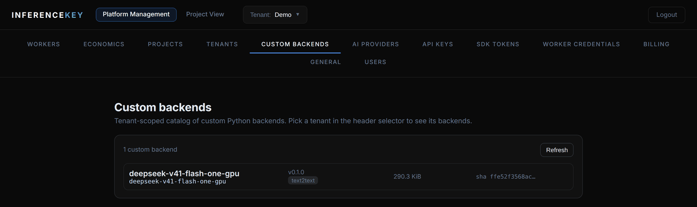
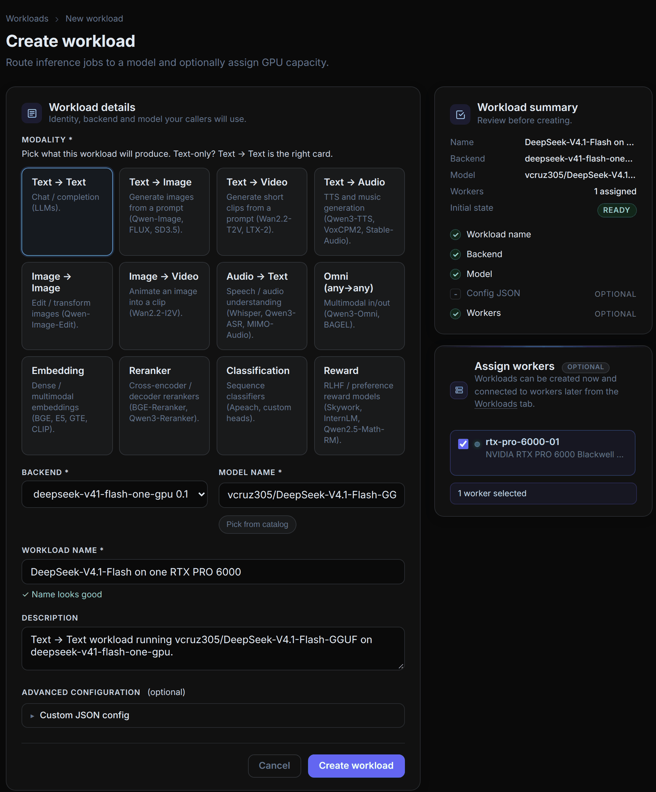
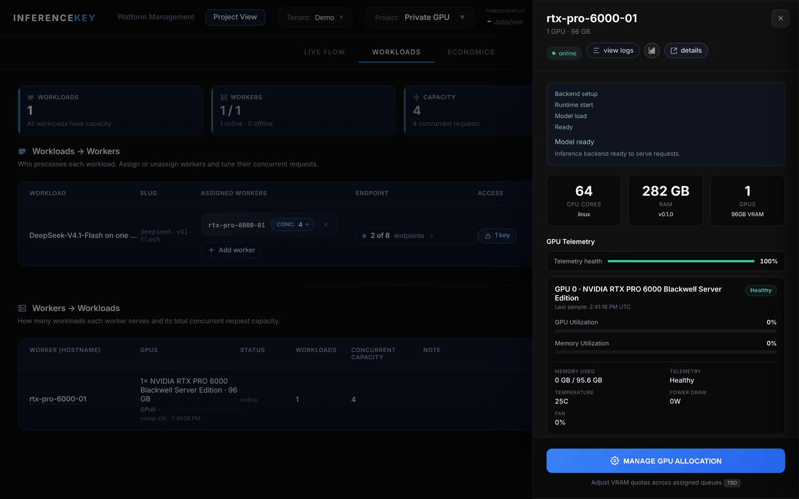
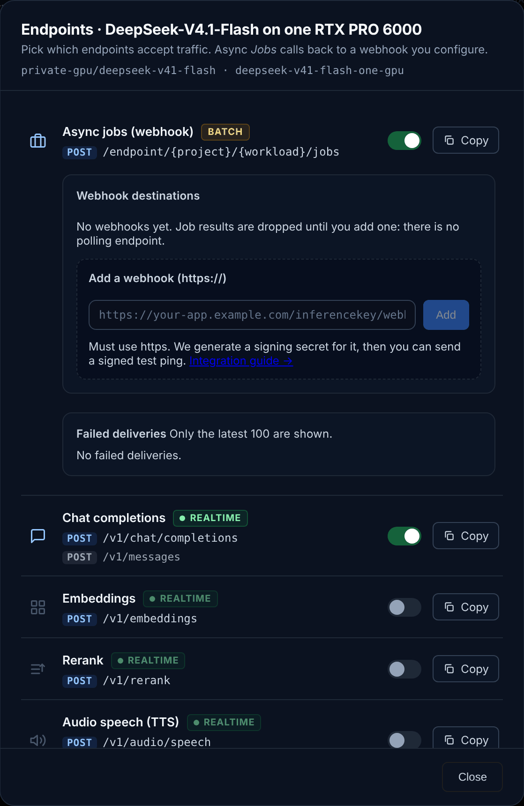
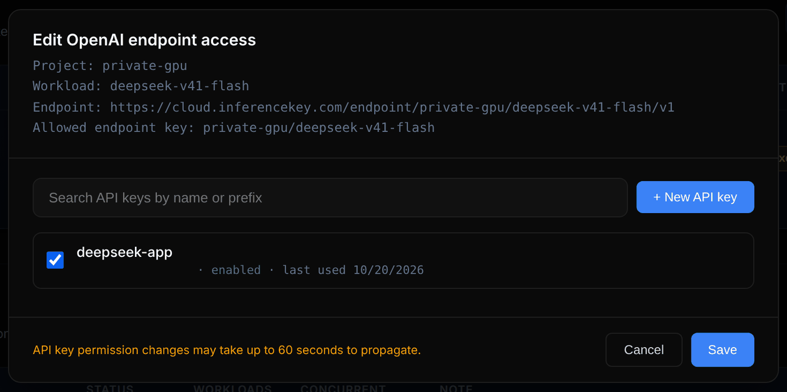
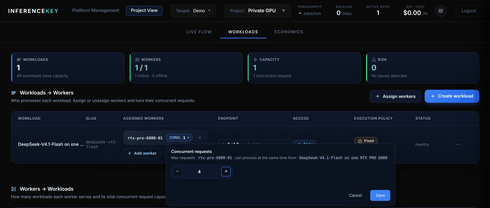
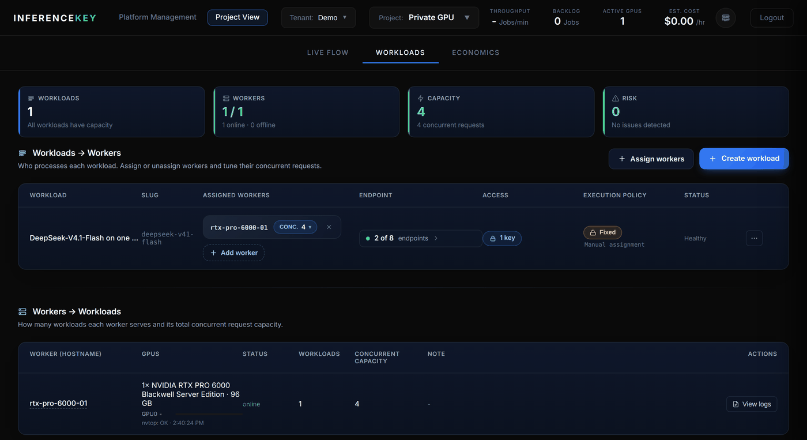

# DeepSeek-V4.1-Flash on your own GPU, through InferenceKey (custom backend)

This folder turns the engine of this repository into an
[InferenceKey](https://inferencekey.com) **custom backend**: you publish it once
with the InferenceKey SDK, pin a workload to your own worker (one RTX PRO 6000
96 GB), and call it from anywhere with the official `openai` client through an
OpenAI-compatible InferenceKey endpoint. The model and its weights stay on your
machine; InferenceKey gives you the endpoint, the API keys and the dashboard.
The InferenceKey docs have the same setup as a step-by-step guide:
[DeepSeek-V4.1-Flash on one 96 GB GPU](https://docs.inferencekey.com/en/guides/deepseek-v41-flash-one-gpu/).

<p align="center"></p>

It follows the SDK's custom backend that brings its own runtime
([`bonsai2-27b-ternary-chat-custom-backend-private-nvidia`](https://github.com/inferencekey/inferencekey-sdk/tree/main/examples/bonsai2-27b-ternary-chat-custom-backend-private-nvidia)):

- `setup()` checks the GPU, downloads the prebuilt engine (release `v0.1.0`,
  `strata-281712ce-cu130-sm120.tar.gz`, checked against its sha256) and the
  GGUF at the pinned revision in parallel, plans the placement with
  `tools/dsv41/pod/e07_gate.py`, writes the server configuration of the
  published runs (README, step 5), starts `serve.server` on a free loopback
  port bound to the GPU's NUMA node, and waits for `/health`.
- `process()` forwards each chat request (messages, sampling fields, and
  `reasoning_effort`, `chat_template_kwargs` or `strata_reproducible` from
  `extra_body`) and returns `{text, reasoning, finish_reason, usage, timings}`.
- The engine's Python side (the server, the placement tool and its two data
  files, about 300 KB packed) travels inside the backend package, so the worker
  needs no clone of this repository. The engine binary bundles its CUDA
  runtime: only the NVIDIA driver comes from the host.

| File | What it does |
| --- | --- |
| `backend.py` | The custom backend (`DeepSeekOneGpuBackend`). |
| `requirements.txt` | Backend dependencies, installed by the worker with uv. |
| `publish.py` | Packages `backend.py` with the engine's Python side (no weights, no binary) and publishes it to your tenant. |
| `main.py` | `ensure()` a fixed workload on your worker, wait until ready, ask one question with the `openai` client, save `outputs/answer.json`, `delete()` (unless `IK_KEEP_ALIVE=1`). |

## What the worker needs

| | |
| --- | --- |
| **GPU** | One NVIDIA RTX PRO 6000 Blackwell, 96 GB, driver 580.65 or newer (CUDA 13). |
| **RAM** | About 280 GB (the placement refuses a host that cannot hold the minimum). |
| **Disk** | About 300 GB free for the 264.5 GB model, under the worker user's `~/.cache/deepseek-one-gpu` (or `DSV41_CACHE_DIR`). |
| **Python** | CPython 3.11 to 3.13 for the backend venv. `numactl` for the NUMA binding (else `taskset`). |
| **Worker setting** | `INFERENCEKEY_CUSTOM_BACKEND_READY_TIMEOUT_SECS=7200` in the worker's environment. The worker waits 300 s for a custom backend by default; the first start downloads 264.5 GB and loading takes a few minutes more. |

To skip the download, put the seven `DeepSeek-V4.1-Flash-Q2_K-*.gguf` files on
the worker first (README, step 3) and set `DSV41_MODEL_DIR` to their folder in
the worker's environment. Every class attribute of `DeepSeekOneGpuBackend` can
be set the same way (`DSV41_<NAME>`).

## Run it

On your laptop (no GPU needed):

```bash
pip install inferencekey openai
cp .env.example .env            # tokens, project, worker id
python publish.py               # once: uploads the backend (about 300 KB) to your tenant
python main.py                  # IK_KEEP_ALIVE=1 to keep the workload afterwards
```

The SDK token needs the scopes `workload:read` and `workload:write`. `main.py`
pins the workload to `IK_WORKER_ID` with the `fixed` policy (one always-on
replica on your GPU) and waits up to `IK_READY_TIMEOUT` seconds (default 7200)
for the first start.

### What it looks like

The InferenceKey dashboard after `publish.py` and `main.py`:

<p align="center"></p>

The same workload from the Create workload form (what `ensure()` declares):

<p align="center"></p>

The worker's drawer, through the backend setup to "Model ready":

<p align="center"></p>

The endpoints the workload answers (chat completions and Anthropic messages) and the API key's access:

<p align="center"></p>

<p align="center"></p>

### Call it from any OpenAI client

The endpoint is `<base>/endpoint/<project>/deepseek-v41-flash/v1` and the model
name is `default`:

```python
import json
from openai import OpenAI

client = OpenAI(base_url="https://cloud.inferencekey.com/endpoint/<project>/deepseek-v41-flash/v1",
                api_key="ik_live_...")
completion = client.chat.completions.create(
    model="default",
    messages=[{"role": "user", "content": "Explain mixture-of-experts models in two sentences."}],
    max_tokens=400,
)
out = json.loads(completion.choices[0].message.content)   # the backend's own object, see below
print(out["text"])
print(out["timings"])
```

### Serve 4 users at once

The engine decodes up to 8 requests in the same step (batch slots). A workload
pinned with `ensure()` starts with **concurrency 1**: InferenceKey sends one
request at a time to the worker. On the Workloads page, click the worker's
`CONC. 1` pill, set "Concurrent requests" to 4 and save:

<p align="center"></p>

<p align="center"></p>
 The measured numbers for this engine
([docs/RESULTS.md](../../docs/RESULTS.md)): 63.11 tok/s for one user, and
127.58 tok/s in total for 4 users at once, 31.87 tok/s for the slowest, on an
RTX PRO 6000 Blackwell Server Edition with an AMD EPYC 9575F, bound to the
GPU's NUMA node.

## Things to know

- **The message content is JSON.** A custom backend answers
  `/v1/chat/completions` with its own object as the message `content`;
  decode it as above (`main.py` does). The real token counts and speeds are
  inside it (`usage`, `timings`): the response's own `usage` is zero.
- **No streaming yet** for custom backends (`"stream": true`).
- **Each request has 300 s** on the worker. When a request sets no `max_tokens`,
  the backend uses 4,096 (about 215 s at the 19 tok/s of a user among 8); ask for
  less, or more when you run alone.
- **No tool calls.** A request with `tools` is refused with 400, as the
  server does (README, "Limitations").
- The platform passes non-OpenAI fields (`reasoning_effort`,
  `strata_reproducible`, ...) in an `extra_body` object of the request JSON.
  The OpenAI Python client's `extra_body=` merges them into the top level
  instead, so send those requests as raw JSON with an `extra_body` object.

## Test the backend without a GPU

`server_engine = "mock"` starts the server's scripted mock engine instead of
the real one (no download, canned text), so the backend's wiring can be checked
on any machine with the SDK's loopback runtime:

```bash
cd integrations/inferencekey
DSV41_SERVER_ENGINE=mock PYTHONPATH=$PWD \
  python -m inferencekey.backend.serve --port 18500 --backend backend:DeepSeekOneGpuBackend &
curl -s localhost:18500/process -H 'Content-Type: application/json' \
  -d '{"id": "1", "input": {"messages": [{"role": "user", "content": "Hello"}]}}'
```

This needs `pip install inferencekey jinja2` and nothing else.

The screenshots are of the InferenceKey dashboard. The speed figures come from
the engine's runs on an RTX PRO 6000 in [docs/RESULTS.md](../../docs/RESULTS.md).
